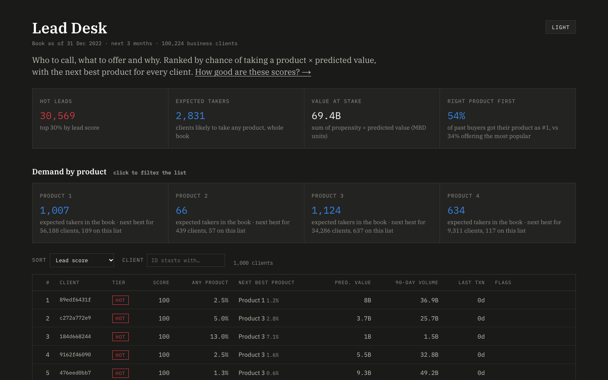
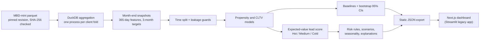

# Bank Lead Scoring

[](https://python.org)
[](src/lead_scoring/data.py)
[](web/)
[](.github/workflows/ci.yml)

A lead-scoring platform for a bank's relationship managers: which clients to call first, how likely each is to take a product in the next 3 months, and what they are worth. It is built around a Bank of India-style RM workflow (CLTV model, propensity model, expected-value lead score, Hot/Medium/Cold tiers, risk flags, scenarios).

**Data:** the first version ran on 500 synthetic customers. This version runs on **real, public bank data**: Sber AI Lab's [MBD-mini](https://huggingface.co/datasets/ai-lab/MBD-mini) (CC BY 4.0), 100,224 business clients and 38.8M transactions from Jan 2021 to Dec 2022, with monthly purchase labels for 4 products. These are **not Bank of India customers**; no public customer-level Bank of India data exists.

**Every number below is measured on later months than the model was trained on, against simple baselines, with a 95% bootstrap interval.** Leakage guards in [`src/lead_scoring/temporal.py`](src/lead_scoring/temporal.py) raise if a split or feature reaches into the future.



## Results

**Question:** at a month-end snapshot, which clients will take any of the bank's 4 products in the next 3 months?

**Split:** train on snapshots Jan, Apr and Jul 2022 (300,672 client-snapshots, 3.3% take a product). Test on the 31 Oct 2022 snapshot, labels Nov 2022 to Jan 2023 (100,224 clients, 2.2% take a product).

### Who to call: ranking clients (test months)

| Model | Lift in top 10% (95% CI) | ROC AUC |
|---|---:|---:|
| Propensity gradient boosting | **3.23 (3.05–3.41)** | 0.736 |
| Logistic regression (baseline) | 3.18 (3.01–3.36) | 0.738 |
| Rule: took a product before, then most active | 2.86 (2.67–3.03) | 0.633 |
| Expected-value lead score (propensity × CLTV) | 2.72 (2.56–2.91) | 0.654 |
| Rule: most transactions in last 90 days | 2.66 (2.48–2.87) | 0.638 |
| Rule: most recent activity first | 1.52 (1.47–1.57) | 0.604 |
| Prior rate (no ranking) | 1.00 (1.00–1.00) | 0.500 |

Headline: calling the top 10% of clients ranked by the propensity model finds 3.2 times as many product takers as calling at random. ROC AUC is 0.736 (0.726–0.747).

- **Gradient boosting ties logistic regression.** The intervals overlap almost completely, so the simpler model would do the same job.
- **Both models beat the best rule**, but only just: the gradient boosting interval starts at 3.05, the rule's ends at 3.03.
- **The expected-value lead score converts less than propensity alone.** Multiplying by CLTV moves high-value clients up even when they are unlikely to buy. Its top decile still holds 27% of all product takers.

### What clients are worth: next-3-month value (test months)

| Model | RMSE |
|---|---:|
| Last 90 days repeat (baseline) | **107M** |
| CLTV gradient boosting | 181M |
| Training-period mean (baseline) | 187M |

The CLTV model loses to "the next 3 months look like the last 3". It was chosen before testing; on a separate validation snapshot (Jul 2022) none of four gradient-boosting variants beat that baseline either ([`cltv_validation.csv`](reports/tables/cltv_validation.csv)). Amounts are MBD's anonymised units, capped at the 0.999 quantile of pre-test transactions because MBD adds noise to amounts.

Full tables: [`reports/tables/model_comparison.csv`](reports/tables/model_comparison.csv), [`metrics_summary.csv`](reports/tables/metrics_summary.csv), [`decile_lift.csv`](reports/tables/decile_lift.csv). Run details: [`reports/run_manifest.json`](reports/run_manifest.json) (git SHA, config, data revision and hashes, package versions).

## What I fixed

The original version reported ROC AUC 0.913 on 500 synthetic customers. An audit ([reports/project_audit.md](reports/project_audit.md)) found:

- **Leakage from the accounts table.** Account count, balance and status were today's values, not values at the training snapshot; 66 of 700 accounts were opened after it. `account_count` alone scored 0.912.
- **A random split** of customers from one snapshot, described as "historical".
- **A leaderboard that favoured the production model**: the "baselines" reused the model's own predictions, and the ranking gave the production model a fixed +0.05 bonus.
- **A CLTV model worse than predicting the mean** (R² −0.37), not mentioned anywhere.
- **No reproducibility**: unpinned packages and no record of what produced the numbers.

Now: real data, a snapshot time split with guards that raise, real baselines with no bonus, bootstrap intervals, pinned versions and a run manifest, and a test ([`tests/test_readme_numbers.py`](tests/test_readme_numbers.py)) that fails if any number above stops matching the result files.

## How it works



- **Features** (14, all known at the snapshot): transaction count, value, maximum and active days over 365 days; count and value over 90 days; recency; tenure; and how many months each product was taken before.
- **Excluded on purpose:** MBD's `trans_count` and `diff_trans_date`. No transaction window reproduces them (best match 11% of rows), so their timing is unknown.
- **Scaling:** MBD's 5 client folds share no clients, so each fold is processed in its own process with DuckDB reading parquet directly. MBD-mini (38.8M transactions) builds a snapshot in about 13 seconds on a laptop; the same code runs the full 2.2M-client MBD fold by fold. The test suite checks that parallel and serial results are identical.
- **Risk flags and scenarios** are heuristic rules, labelled as such, not fitted models.

## Run it

```bash
python3 -m venv .venv && .venv/bin/pip install -r requirements.txt
.venv/bin/python scripts/fetch_mbd.py        # ~2 GB download, SHA-256 checked, nothing committed
.venv/bin/python scripts/run_pipeline.py     # about 5 minutes on a laptop
.venv/bin/python scripts/cltv_validation.py  # CLTV model choice on the Jul 2022 validation snapshot
.venv/bin/python scripts/repo_health_check.py
.venv/bin/python -m pytest -q                # runs on small fixtures; no download needed
cd web && npm install && npm run dev         # dashboard at http://localhost:3000
```

The legacy Streamlit app: `streamlit run app/streamlit_app.py`.

## Data and licence

| Data | Source | Real? | In git? |
|---|---|---|---|
| MBD-mini `targets` and `detail/trx` | [Hugging Face ai-lab/MBD-mini](https://huggingface.co/datasets/ai-lab/MBD-mini), revision `4b0d5b4c` | Real, anonymised, noise added by the publisher | No (`scripts/fetch_mbd.py`) |

Cite: Mollaev et al., *Multimodal Banking Dataset: Understanding Client Needs through Event Sequences*, [arXiv:2409.17587](https://arxiv.org/abs/2409.17587). Licence CC BY 4.0. Details in [data/README.md](data/README.md).

## Limitations

- Business clients of a Russian bank, not Bank of India retail customers; the workflow carries over, the numbers may not.
- The 4 products are unnamed in the source data.
- One test window (Nov 2022 to Jan 2023). The purchase rate fell from 3.3% in training to 2.2% in the test months, so calibration drifts.

## Resume bullets

- Rebuilt a bank lead-scoring platform on 100,224 real business clients and 38.8M transactions (Sber MBD, 2021–2022), replacing 500 synthetic rows. Found and removed account-table leakage and a random split behind a reported 0.913 AUC.
- Measured on later months with a leakage-guarded time split: top-10% lift 3.23 (95% CI 3.05–3.41) and AUC 0.736, beating the best business rule (2.86) and tying logistic regression; showed a last-90-days baseline beat the CLTV model on RMSE (107M vs 181M).
- Scaled feature engineering with DuckDB processing client folds in parallel (one snapshot of 38.8M transactions in about 13 s), with pinned data hashes, a run manifest and CI tests that check every README number against the result files.
