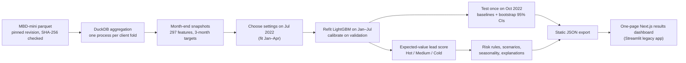

# Bank Lead Scoring

[](https://python.org)
[](src/lead_scoring/data.py)
[](web/)
[](https://bank-lead-scoring-one.vercel.app)
[](.github/workflows/ci.yml)

A lead-scoring platform for a bank's relationship managers: which clients to call first, how likely each is to take a product in the next 3 months, and what they are worth. It is built around a Bank of India-style RM workflow (CLTV model, propensity model, expected-value lead score, Hot/Medium/Cold tiers, risk flags, scenarios).

**Data:** the first version ran on 500 synthetic customers. This version runs on **real, public bank data**: Sber AI Lab's [MBD-mini](https://huggingface.co/datasets/ai-lab/MBD-mini) (CC BY 4.0), 100,224 business clients and 38.8M transactions from Jan 2021 to Dec 2022, with monthly purchase labels for 4 products. These are **not Bank of India customers**; no public customer-level Bank of India data exists.

**Every number below is measured on later months than the model was trained on, against simple baselines, with a 95% bootstrap interval.** Every model setting was chosen on a separate validation month, and the test month was scored once. Leakage guards in [`src/lead_scoring/temporal.py`](src/lead_scoring/temporal.py) raise if a split or feature reaches into the future.

**Live results dashboard: [bank-lead-scoring-one.vercel.app](https://bank-lead-scoring-one.vercel.app)**

[](https://bank-lead-scoring-one.vercel.app)

The dashboard opens on the **Lead Desk**, the view an RM team works from: the top 1,000 clients of the 31 Dec 2022 book ranked by lead score, each with a next best product, the chance of each product, the three strongest reasons behind the score, recent activity and rule-based flags. Filter by product, sort, search, and click a client for detail. The model evidence is one click away at [`/results`](https://bank-lead-scoring-one.vercel.app/results).

## Results

**Question:** at a month-end snapshot, which clients will take any of the bank's 4 products in the next 3 months?

**Split:** settings are chosen on a validation month: fit on the Jan–Apr 2022 month-ends, validate on 31 Jul 2022. The chosen model is then refit on the 7 month-ends Jan–Jul 2022 (701,568 client-snapshots, 3.4% take a product) and tested once on the 31 Oct 2022 snapshot, labels Nov 2022 to Jan 2023 (100,224 clients, 2.2% take a product).

### Who to call: ranking clients (test months)

| Model | Lift in top 10% (95% CI) | ROC AUC |
|---|---:|---:|
| **LightGBM (production)** | **4.01 (3.85–4.25)** | **0.787** |
| Logistic regression on the same features (baseline) | 3.76 (3.58–3.98) | 0.775 |
| Previous model: gradient boosting on 14 features | 3.24 (3.04–3.40) | 0.738 |
| Expected-value lead score (propensity × CLTV) | 3.15 (2.99–3.35) | 0.686 |
| Rule: took a product before, then most active | 2.86 (2.67–3.03) | 0.633 |
| Rule: most transactions in last 90 days | 2.66 (2.48–2.87) | 0.638 |
| Rule: most recent activity first | 1.52 (1.47–1.57) | 0.604 |
| Prior rate (no ranking) | 1.00 (1.00–1.00) | 0.500 |

Headline: calling the top 10% of clients ranked by LightGBM finds 4.0 times as many product takers as calling at random. ROC AUC is 0.787 (0.778–0.796), up from 0.738 for the previous model on the same test rows.

- **Most of the gain comes from the features, not the model.** Logistic regression on the new features reaches 0.775 AUC, against 0.738 for gradient boosting on the old 14. LightGBM adds the rest; its AUC interval barely overlaps logistic regression's.
- **On validation (Jul 2022) the same model scored lower:** validation AUC 0.774, lift 3.55. The test month has fewer buyers (2.2% against 2.8%), which leaves more room for lift, and the final refit sees more purchase history. Quote both.
- **The expected-value lead score converts less than propensity alone.** Multiplying by CLTV moves high-value clients up even when they are unlikely to buy. Its top decile still holds 32% of all product takers.

### What changed the model, measured on validation

| Step | Validation AUC | Top-10% lift |
|---|---:|---:|
| LightGBM on transaction-mix and 2-month product-history features | 0.762 | 3.29 |
| + the snapshot month's purchases and months since the last purchase | 0.768 | 3.46 |
| + dialog counts and days since the last dialog | 0.774 | 3.55 |

Tried and not kept, each judged on validation: label-chosen category codes (lower AUC), mean dialog embeddings (no gain), one LightGBM per product (+0.002 AUC), snapshot weighting, seed bagging and ranking objectives (each within 0.001). A GRU over each client's last 512 transactions reached 0.746 on its own; blended with LightGBM it added 0.001, below the 0.005 bar, so production uses GRU weight 0.00. Details: [the strategy log](docs/plans/2026-10-25-auc-lift-strategy.md).

### Next-month, per-product AUC next to the MBD paper

| Model | Mean AUC | Product 1 | Product 2 | Product 3 | Product 4 |
|---|---:|---:|---:|---:|---:|
| LightGBM, one model per product (this repo) | 0.832 | 0.823 | 0.820 | 0.815 | 0.870 |
| Published: transaction aggregates | 0.783 | | | | |
| Published best: supervised RNN, transactions + geo + dialogs | 0.824 | | | | |

This is not a like-for-like comparison. The paper ([arXiv 2409.17587](https://arxiv.org/abs/2409.17587)) uses full MBD (2.2M clients) with client folds; this repo uses MBD-mini, a time split, and transactions plus dialog timestamps. Product 4 at 0.870 is above the project's 0.85 audit line. The audit found no single feature that explains it (the best scores 0.72), and every feature is built from events before the snapshot. Product 2 has only about 50 next-month buyers in the validation month, so its numbers are noisy.

### What to offer: next best product (test months)

One LightGBM per product predicts who takes it in the next 3 months, reusing the any-product settings chosen on validation. The client is offered the product ranked highest.

| Measure | LightGBM per product | Baseline: most popular product |
|---|---:|---:|
| Buyers whose product was ranked first (2,173 buyers) | **54.2%** | 34.1% |

Per-product 3-month AUC: 0.781, 0.804, 0.775 and 0.858 for products 1–4. Product 4 is above the 0.85 audit line; its strongest single feature scores 0.74. Table: [`next_product_test.csv`](reports/tables/next_product_test.csv).

### What clients are worth: next-3-month value (test months)

| Model | RMSE |
|---|---:|
| Last 90 days repeat (baseline) | **107M** |
| CLTV gradient boosting | 138M |
| Training-period mean (baseline) | 187M |

The CLTV model loses to "the next 3 months look like the last 3". It was chosen before testing; on a separate validation snapshot (Jul 2022) none of four gradient-boosting variants beat that baseline either ([`cltv_validation.csv`](reports/tables/cltv_validation.csv)). Amounts are MBD's anonymised units, capped at the 0.999 quantile of pre-test transactions because MBD adds noise to amounts.

Full tables: [`model_comparison.csv`](reports/tables/model_comparison.csv), [`metrics_summary.csv`](reports/tables/metrics_summary.csv), [`decile_lift.csv`](reports/tables/decile_lift.csv), [`propensity_validation.csv`](reports/tables/propensity_validation.csv), [`paper_protocol.csv`](reports/tables/paper_protocol.csv). Run details: [`reports/run_manifest.json`](reports/run_manifest.json) (git SHA, config, data revision and hashes, package versions).

## What I fixed

The original version reported ROC AUC 0.913 on 500 synthetic customers. An audit ([reports/project_audit.md](reports/project_audit.md)) found:

- **Leakage from the accounts table.** Account count, balance and status were today's values, not values at the training snapshot; 66 of 700 accounts were opened after it. `account_count` alone scored 0.912.
- **A random split** of customers from one snapshot, described as "historical".
- **A leaderboard that favoured the production model**: the "baselines" reused the model's own predictions, and the ranking gave the production model a fixed +0.05 bonus.
- **A CLTV model worse than predicting the mean** (R² −0.37), not mentioned anywhere.
- **No reproducibility**: unpinned packages and no record of what produced the numbers.

Now: real data, a snapshot time split with guards that raise, real baselines with no bonus, bootstrap intervals, pinned versions and a run manifest, and a test ([`tests/test_readme_numbers.py`](tests/test_readme_numbers.py)) that fails if any number above stops matching the result files.

## How it works



- **Features** (297, all known at the snapshot): transaction counts and amounts over 365 and 90 days and for each of the last 6 months; counts of the 10 most common values of each transaction category; days since each common event type; purchase flags for the snapshot month and the 2 months before it, and months since the last purchase, per product; dialog counts over 30, 90 and 365 days and days since the last dialog.
- **Label timing:** a purchase row stamped month M is read as "bought during M", so the snapshot month's purchases are history. The evidence is in [data/README.md](data/README.md). A check stops the run if any single feature alone passes 0.80 validation AUC.
- **Excluded on purpose:** MBD's `trans_count` and `diff_trans_date`. No transaction window reproduces them (best match 11% of rows), so their timing is unknown.
- **Model choice:** a 4-setting LightGBM grid, early-stopped on validation; the final refit uses the best round count × 7/4 for the larger training set. The choice is saved in [`models/propensity_choice.json`](models/propensity_choice.json), and the pipeline reads it.
- **Scaling:** MBD's 5 client folds share no clients, so each fold is processed in its own process with DuckDB reading parquet directly. The test suite checks that parallel and serial results are identical.
- **Risk flags and scenarios** are heuristic rules, labelled as such, not fitted models.

## Run it

```bash
python3 -m venv .venv && .venv/bin/pip install -r requirements.txt
.venv/bin/python scripts/fetch_mbd.py                 # ~2 GB download, SHA-256 checked, nothing committed
.venv/bin/python -m lead_scoring.data                 # feature build, about an hour on a laptop
.venv/bin/python -m lead_scoring.features
.venv/bin/python scripts/train_gru.py --stage validate  # optional: GRU validation scores for the blend check
.venv/bin/python scripts/validate_propensity.py       # choose LightGBM settings and the blend on Jul 2022
.venv/bin/python scripts/run_pipeline.py              # rebuilds features, then refit, test, scores, reports, dashboard data
.venv/bin/python scripts/cltv_validation.py           # CLTV model choice on the Jul 2022 validation snapshot
.venv/bin/python -m pytest -q                         # runs on small fixtures; no download needed
cd web && npm install && npm run dev                  # dashboard at http://localhost:3000
```

`scripts/test_propensity.py` scored the test month once and refuses to run again while `reports/tables/propensity_test.csv` exists. The legacy Streamlit app: `streamlit run app/streamlit_app.py`.

## Data and licence

| Data | Source | Real? | In git? |
|---|---|---|---|
| MBD-mini `targets`, `detail/trx` and `detail/dialog` (timestamps only) | [Hugging Face ai-lab/MBD-mini](https://huggingface.co/datasets/ai-lab/MBD-mini), revision `4b0d5b4c` | Real, anonymised, noise added by the publisher | No (`scripts/fetch_mbd.py`) |

Cite: Mollaev et al., *Multimodal Banking Dataset: Understanding Client Needs through Event Sequences*, [arXiv:2409.17587](https://arxiv.org/abs/2409.17587). Licence CC BY 4.0. Details in [data/README.md](data/README.md).

## Limitations

- Business clients of a Russian bank, not Bank of India retail customers; the workflow carries over, the numbers may not.
- The 4 products are unnamed in the source data.
- One test window (Nov 2022 to Jan 2023). The purchase rate fell from 3.4% in training to 2.2% in the test months, so calibration drifts.
- In the validation month, 15.8% of buyers had no transactions in the year before the snapshot; both LightGBM and the GRU rank that group barely better than chance.

## Resume bullets

- Rebuilt a bank lead-scoring platform on 100,224 real business clients and 38.8M transactions (Sber MBD, 2021–2022), replacing 500 synthetic rows. Found and removed account-table leakage and a random split behind a reported 0.913 AUC.
- Raised propensity AUC from 0.738 to 0.787 and top-10% lift from 3.24× to 4.01× on a held-out month (95% CI 3.85–4.25), with every setting chosen on a separate validation month, by adding purchase-history, transaction-mix and dialog features to LightGBM; tested and rejected a PyTorch GRU on raw transaction sequences that added under 0.005 AUC.
- Scaled feature engineering with DuckDB processing client folds in parallel, with leakage guards that stop the run, pinned data hashes, a run manifest and CI tests that check every README number against the result files.
